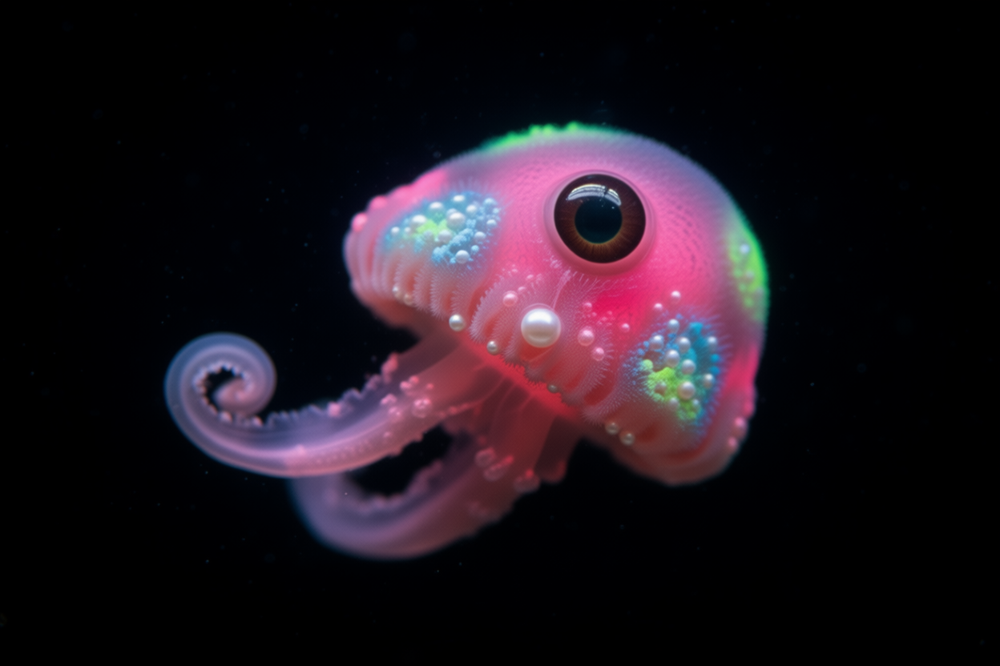
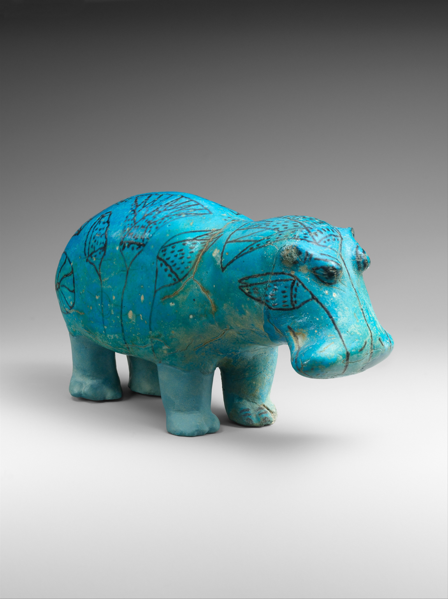
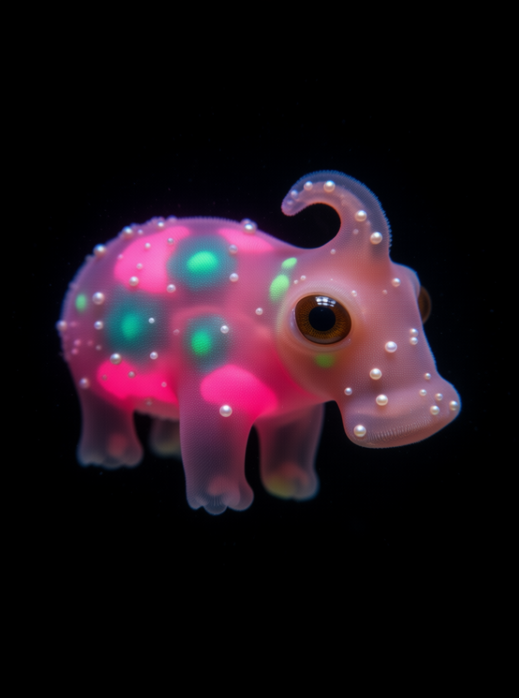

# Abyss

> Any object photo becomes a living bioluminescent deep-sea specimen, turning slowly in the dark.

An entry for Comfy's [Open Source Higgsfield](https://comfy.org/open-source-higgsfield) competition. #OpenSourceHiggsfield

Open weights only, core ComfyUI nodes only. **No closed APIs, no partner nodes.** Repo licensed Apache-2.0 (the
LTX-2.3 / Gemma weights used for the video are not; see Model licenses).

AI-generated (Qwen-Image-Edit-2511, `workflows/abyss-specimen.json`, seed `424242424242`).

Demo (AI-generated): [`examples/abyss_demo.mp4`](examples/abyss_demo.mp4).

## Concept

Give it any object photo. Abyss keeps the object's silhouette and pose but turns it into a living deep-sea creature:
soft, gummy, translucent flesh glowing from inside with hot pink, magenta and violet bioluminescence, on pure black.
Then the specimen comes alive on video and turns slowly in the dark.

## Pipeline

1. **Specimen still** (`workflows/abyss-specimen.json`): Qwen-Image-Edit-2511 (fp8, open weights) turns the object
   photo into the specimen still. Lightning off (40 steps, CFG 3), euler / simple, seed `424242424242`.
2. **Image to video** (`workflows/abyss-spin.json`, `workflows/abyss-tumble.json`): LTX-2.3 image-to-video with
   audio (open weights, official Comfy-Org template) takes the specimen still as its first frame and makes ~5 s of
   footage at 960x640, seed `20261103`. `abyss-spin` asks for a steady spin in the image plane; `abyss-tumble` asks for
   a slow tumble in place. Both add underwater ambience as audio.
3. **Composite** (`tools/film.py`): a simple ffmpeg/PIL edit that adds the slow Z roll. The Z roll is applied in
   compositing, not generated by the video model.

### Honest note

The LTX spin of the hippo drifted out of frame, so it is not used. In the demo, the hippo appears as its specimen
still (`examples/specimen_hippo.png`) with the Z roll composited on top. The netsuke uses its LTX spin clip
(`examples/abyss_spin_netsuke.mp4`).

## Requirements

- ComfyUI 0.16.4 or newer (desktop, portable or self-hosted), or Comfy Cloud (models preinstalled).
- Core nodes only. No custom nodes, no partner nodes, no paid APIs.
- The video needs a large GPU (or Comfy Cloud) and the LTX-2.3 / Gemma rows below.
- Composite step: Python 3.9+, Pillow, NumPy and ffmpeg on your PATH.
- These model files:

| File | Put in `ComfyUI/models/…` | Download | License |
|---|---|---|---|
| `qwen_image_edit_2511_fp8mixed.safetensors` | `diffusion_models/` | [link](https://huggingface.co/Comfy-Org/Qwen-Image-Edit_ComfyUI/resolve/main/split_files/diffusion_models/qwen_image_edit_2511_fp8mixed.safetensors) | Apache-2.0 (upstream https://huggingface.co/Qwen/Qwen-Image-Edit-2511) |
| `qwen_2.5_vl_7b_fp8_scaled.safetensors` | `text_encoders/` | [link](https://huggingface.co/Comfy-Org/HunyuanVideo_1.5_repackaged/resolve/main/split_files/text_encoders/qwen_2.5_vl_7b_fp8_scaled.safetensors) | Apache-2.0 (upstream https://huggingface.co/Qwen/Qwen2.5-VL-7B-Instruct) |
| `qwen_image_vae.safetensors` | `vae/` | [link](https://huggingface.co/Comfy-Org/Qwen-Image_ComfyUI/resolve/main/split_files/vae/qwen_image_vae.safetensors) | Apache-2.0 (Qwen-Image) |
| `Qwen-Image-Edit-2511-Lightning-4steps-V1.0-bf16.safetensors` | `loras/` | [link](https://huggingface.co/lightx2v/Qwen-Image-Edit-2511-Lightning/resolve/main/Qwen-Image-Edit-2511-Lightning-4steps-V1.0-bf16.safetensors) | Apache-2.0 (HF card metadata) |
| `ltx-2.3-22b-dev-fp8.safetensors` (video only) | `checkpoints/` | [link](https://huggingface.co/Lightricks/LTX-2.3-fp8/resolve/main/ltx-2.3-22b-dev-fp8.safetensors) | **LTX-2 Community License** (not Apache) |
| `ltx_2.3_22b_distilled_1.1_lora_dynamic_fro09_avg_rank_111_bf16.safetensors` (video only) | `loras/` | [link](https://huggingface.co/Comfy-Org/ltx-2.3/resolve/main/split_files/loras/ltx_2.3_22b_distilled_1.1_lora_dynamic_fro09_avg_rank_111_bf16.safetensors) | **LTX-2 Community License** |
| `ltx-2.3-spatial-upscaler-x2-1.1.safetensors` (video only) | `latent_upscale_models/` | [link](https://huggingface.co/Lightricks/LTX-2.3/resolve/main/ltx-2.3-spatial-upscaler-x2-1.1.safetensors) | **LTX-2 Community License** |
| `gemma_3_12B_it_fp4_mixed.safetensors` (video only) | `text_encoders/` | [link](https://huggingface.co/Comfy-Org/ltx-2/resolve/main/split_files/text_encoders/gemma_3_12B_it_fp4_mixed.safetensors) | **Gemma Terms of Use** (not Apache) |

### Model licenses: the video is not Apache

- **LTX-2.3** (checkpoint, distilled LoRA, upscaler) is under the
  [LTX-2 Community License Agreement](https://github.com/Lightricks/LTX-2/blob/main/LICENSE-2), not Apache-2.0: open
  weights, not OSI; entities with US$10M+ annual revenue need a commercial license; use restrictions apply.
- The **Gemma 3** text encoder is under the [Gemma Terms of Use](https://ai.google.dev/gemma/terms).
- **AI-generated output must be disclosed.** The LTX-2 license requires machine-generated content to be clearly
  labelled as such. Label anything you post from this repo as AI-generated.
- The "abliterated" Gemma LoRA from the official LTX-2.3 template is **not** used. The bypassed `LoraLoader` inside
  the LTX subgraph is an empty optional slot and is not needed.
- The still uses only Apache-2.0 weights (Qwen-Image-Edit-2511, Qwen2.5-VL, Qwen VAE, optional Lightning LoRA).

Details: `THIRD_PARTY_NOTICES.md` and `NOTICE`. Not legal advice.

## Setup and run locally in ComfyUI

1. Install or update ComfyUI (or open Comfy Cloud).
2. Download the model files above (the LTX/Gemma rows only for the video) into the listed `ComfyUI/models/`
   folders. On Comfy Cloud, skip this and pick the same file names in the loader widgets.
3. Copy `inputs/netsuke.png` and `inputs/hippo.png` into `ComfyUI/input/`.
4. **Specimen still:** drag `workflows/abyss-specimen.json` onto the canvas. The Load Image node defaults to
   `netsuke.png`; pick `hippo.png` for the second object. Press **Run**. Output:
   `ComfyUI/output/abyss/specimen_netsuke_*.png`.
5. **Video:** copy the specimen still into `ComfyUI/input/` as `abyss_specimen.png`, drag `workflows/abyss-spin.json`
   (or `workflows/abyss-tumble.json`) onto the canvas, press **Run**. Output:
   `ComfyUI/output/video/abyss_spin_netsuke_*.mp4` (or `abyss_tumble_*.mp4`). Expect to need a large GPU or Comfy Cloud.
6. **Composite:** put the clips and stills in `examples/` (or use the ones shipped there) and run
   `python3 tools/film.py` from the repo root. See the top of that file for its inputs and output.

Seeds are fixed (`424242424242` for the still, `20261103` for the video), so the workflows reproduce the examples
on the same models.

## Examples

All are AI-generated (Comfy Cloud, 2026-11-03 ET).

| Input | Specimen still |
|---|---|
|  |  |
|  |  |

- `examples/abyss_spin_netsuke.mp4`: `abyss-spin.json` on the netsuke specimen (LTX-2.3, ~5 s, with audio).
- `examples/abyss_tumble.mp4`: `abyss-tumble.json` (LTX-2.3, ~5 s, with audio).
- `examples/abyss_demo.mp4`: the composite edit.

## Credits and sources

- Input images: public-domain (CC0) objects from The Metropolitan Museum of Art Open Access: Hippopotamus
  ("William"), ca. 1961–1878 B.C., Egypt, Middle Kingdom, acc. no. 17.9.1; Netsuke, 18th century, Japan,
  acc. no. 10.211.2273. Object pages, original URLs and hashes: `SOURCES.md`.
- Workflow graphs adapted from the official Comfy-Org templates `image_qwen_image_edit_2511.json` and
  `video_ltx2_3_i2v.json` (MIT); see `THIRD_PARTY_NOTICES.md`.
- Models: Qwen-Image-Edit-2511 and Qwen2.5-VL by the Qwen team; Lightning LoRA by lightx2v; LTX-2.3 by Lightricks; Gemma 3 by Google.

## License

This repo (workflows, script, docs) is licensed under the [Apache License 2.0](LICENSE); see `NOTICE`.

- The workflow graphs are adapted from MIT-licensed Comfy-Org templates; see `THIRD_PARTY_NOTICES.md`.
- Input images are CC0 (`SOURCES.md`).
- Model weights are not included and keep their own licenses: the Qwen still is Apache-2.0; the video uses LTX-2.3
  (LTX-2 Community License) and Gemma 3 (Gemma Terms of Use).

#OpenSourceHiggsfield
